# ExpenseTracker — Master Product & Architecture Enhancement Plan

> **Document Type**: Living Product Roadmap & Engineering Blueprint  
> **Status**: Active & Approved for Phased Execution  
> **Version**: 2.0 (November 2026)  
> **Workspace Path**: `c:\Users\USER\StudioProjects\ExpenseTracker\MASTER_PROJECT_ENHANCEMENT_PLAN.md`

---

## Table of Contents
1. [Roadmap Architecture & Phase Sequence](#1-roadmap-architecture--phase-sequence)
2. [Phase 1: Immediate Bug Fixes & UX Harmonization](#2-phase-1-immediate-bug-fixes--ux-harmonization)
3. [Phase 2: Advanced Category & Subcategory Comparison Engine](#3-phase-2-advanced-category--subcategory-comparison-engine)
4. [Phase 3: Home Screen Glance App Widget (Payday & Pacing)](#4-phase-3-home-screen-glance-app-widget-payday--pacing)
5. [Phase 4: Multi-Currency & Travel Mode Platform](#5-phase-4-multi-currency--travel-mode-platform)
6. [Phase 5: Innovative Market-Differentiating Features](#6-phase-5-innovative-market-differentiating-features)
7. [Phase 6: Actionable Enhancements for Existing Features](#7-phase-6-actionable-enhancements-for-existing-features)
8. [Phase 7: Business, Monetization & 3-Month Pro Trial Engine](#8-phase-7-business-monetization--3-month-pro-trial-engine)
9. [Phase 8: Architecture, SMS Ingestion & Auto-Deductions](#9-phase-8-architecture-sms-ingestion--auto-deductions)
10. [Phase 9: Documentation Overhaul, Verification & QA Matrices](#10-phase-9-documentation-overhaul-verification--qa-matrices)
11. [Decisions & Strategic Questions (Next Steps)](#11-decisions--strategic-questions-next-steps)
12. [Progress Tracking & Status Log](#12-progress-tracking--status-log)

---

## 1. Roadmap Architecture & Phase Sequence

The roadmap is structured into 9 sequential, self-contained phases. Each phase concludes with unit verification, database migration integrity, and documentation synchronization before the next begins.

```mermaid
flowchart TD
    P1["Phase 1: Immediate Bug Fixes & UX Harmonization<br/>(Athan Icon, Wallet/Vault Exclusion, Split Location, Salary Math)"]
    P2["Phase 2: Advanced Category & Subcategory Comparison Engine<br/>(Day-Pacing, Expandable Waterfall, Txn Drilldown)"]
    P3["Phase 3: Home Screen Glance App Widget<br/>(Payday Countdown, Safe Burn Rate, Quick Add)"]
    P4["Phase 4: Multi-Currency & Travel Mode Platform<br/>(JOD/USD/AED/SAR, Exchange Tracker, Trip Pacing)"]
    P5["Phase 5: Innovative Market-Differentiating Features<br/>(Price Memory, Sadaqah Jar, Runway Tester, Murabaha Sim)"]
    P6["Phase 6: Actionable Enhancements for Existing Features<br/>(Numpad Calc, Offline OCR, WhatsApp Reminders, Real .xlsx)"]
    P7["Phase 7: Business, Monetization & 3-Month Pro Trial<br/>(Freemium Layer, 90-Day Local Device Trial, Feature Gates)"]
    P8["Phase 8: Architecture, SMS Ingestion & Auto-Deductions<br/>(Bank SMS Review Inbox, Recurring Auto-Deduct, UseCases)"]
    P9["Phase 9: Documentation Overhaul & Full QA Hardening<br/>(Sync all 4 Core Docs, Regression Tests, QA Checklist)"]

    P1 --> P2 --> P3 --> P4 --> P5 --> P6 --> P7 --> P8 --> P9

    style P1 fill:#10B981,color:#fff
    style P2 fill:#0284C7,color:#fff
    style P3 fill:#3B82F6,color:#fff
    style P4 fill:#6366F1,color:#fff
    style P5 fill:#8B5CF6,color:#fff
    style P6 fill:#EC4899,color:#fff
    style P7 fill:#F59E0B,color:#fff
    style P8 fill:#EF4444,color:#fff
    style P9 fill:#64748B,color:#fff
```



---

## 2. Phase 1: Immediate Bug Fixes & UX Harmonization

### 1.1 Athan Notification Large App Icon
* **Current State**: `NotificationHelper.showPrayerReminderNotification()` in [NotificationHelper.kt](file:///c:/Users/USER/StudioProjects/ExpenseTracker/app/src/main/java/com/example/expensetracker/util/NotificationHelper.kt) sets `.setSmallIcon(R.drawable.mosque)`, but omits `appIconBitmap?.let { builder.setLargeIcon(it) }`.
* **Fix**:
  - Keep `R.drawable.mosque` as the status-bar small icon.
  - Add `appIconBitmap?.let { builder.setLargeIcon(it) }` to match daily reminder, loan, and budget alerts, ensuring the prominent right-hand badge displays the official application icon.

### 1.2 Strict Wallet & Vault (Deposit) Spending Exclusion
* **Current State**:
  - `AccountType.DEPOSIT` is hardcoded to be excluded from `periodExpense` in `BalanceCalculator`.
  - `AccountType.WALLET` expenses are currently only excluded if the user manually checks `"Exclude from monthly expense calculation"`. If untoggled, pocket-money wallet spending pollutes the salary-cycle expense total and burns category budgets.
* **Fix**:
  - Update [BalanceCalculator.kt](file:///c:/Users/USER/StudioProjects/ExpenseTracker/app/src/main/java/com/example/expensetracker/domain/BalanceCalculator.kt), [SpendingPacingCalculator.kt](file:///c:/Users/USER/StudioProjects/ExpenseTracker/app/src/main/java/com/example/expensetracker/domain/SpendingPacingCalculator.kt), and [BudgetProgressCalculator.kt](file:///c:/Users/USER/StudioProjects/ExpenseTracker/app/src/main/java/com/example/expensetracker/domain/BudgetProgressCalculator.kt) so that any expense where `accountType == AccountType.WALLET` or `accountType == AccountType.DEPOSIT` is **automatically and permanently excluded** from monthly expenses.
  - Transactions remain fully visible in `HistoryScreen`, filterable by account, and correctly deduct from Wallet or Vault balances without distorting monthly operational cash flow.

### 1.3 Salary Period "Carry Forward" Mechanics Clarification & Hardening
When adding an Income transaction in the `Salary` category:
```
┌────────────────────────────────────────────────────────┐
│  Start new salary month?                               │
│  Set Nov 25, 2026 as the start of your salary month?   │
│                                                        │
│  [x] Bring previous balance                            │
│      Adds +145.500 JOD from previous savings           │
│                                                        │
│  [ No, just normal income ]    [ Yes, start new month ]│
└────────────────────────────────────────────────────────┘
```
* **"Yes, start new month" + Checkbox Checked**:
  - Sets `startsNewPeriod = true` (new period anchor date).
  - Sets `carriedForwardBalance = previousSavings` (e.g. 145.500 JOD).
  - In `MonthSummary`: `Remaining Total = Carried Savings + New Salary - Expenses`.
* **"Yes, start new month" + Checkbox Unchecked**:
  - Sets `startsNewPeriod = true`.
  - Sets `carriedForwardBalance = null`.
  - Period starts fresh: only the new salary counts toward this month's net activity. Unspent money from last month remains in liquid Cash/Bank balances ("Money now") but does not inflate the new month's income pool.
* **"No, just normal income"**:
  - Sets `startsNewPeriod = false` and `carriedForwardBalance = null`.
  - Adds funds to Cash/Bank without altering salary cycle boundaries.

### 1.4 Smart Financial Insights Status Engine & Pacing Math
* **5 Pacing Statuses**:
  1. 🟢 `SUPER_SAVER` ($V < 0.70$): Spending far below daily allowance.
  2. 🔵 `OPTIMAL` ($0.70 \le V \le 1.05$): Spending velocity on track with calendar time.
  3. 🟡 `MODERATE_BURN` ($1.05 < V \le 1.30$, or first 5 days): Elevated outlays with early-cycle damping.
  4. 🟠 `HIGH_BURN` ($V > 1.30$): Run-rate exceeds sustainable allowance.
  5. 🔴 `DEFICIT_CRITICAL` ($\text{Expense} \ge \text{Baseline}$): Budget exhausted.
* **Spendable Baseline Formulation**:
  $$\text{SpendableBudget} = \max(0.0, \; \text{MonthlyIncome} + \text{CarriedForwardBalance} - \text{WalletAllocation})$$
  Excludes unallocated external liquid reserves, strictly evaluating the active month's operational spending envelope.

### 1.5 Add Transaction Screen: Redesigned Split Transaction Location
* **Problem**: Currently placed below the Amount field, while single Subcategory is above Amount.
* **Redesign**:
  - Add a top-level Segmented Control immediately below Transaction Type:
    `[ Single Transaction ] | [ Split Items ✂️ ]`
  - Selecting **"Split Items"** cleanly hides the single Category, single Subcategory, and single Amount fields, replacing them with the interactive `SplitTransactionSection` card with real-time balance calculations.

---

## 3. Phase 2: Advanced Category & Subcategory Comparison Engine

### 2.1 The Visual Experience & Wireframe

```
┌────────────────────────────────────────────────────────┐
│  📊 Category & Subcategory Comparison                  │
│                                                        │
│  Base:   [ Oct 2026 (Day 15) ▼ ]                       │
│  Compare:[ Sep 2026          ▼ ]                       │
│  Mode:   (•) Day-to-Day Normalized    ( ) Full Month   │
├────────────────────────────────────────────────────────┤
│  🎯 Category Trend Leaderboard                         │
│  Tap category to expand subcategory waterfall:         │
│                                                        │
│  🛒 Shopping          245.000 vs 190.000   [ +28.9% ⚠️ ]│
│  ├─ 🍗 Chicken & Meat 110.000 vs  75.000   [ +46.7% ↑ ]│
│  ├─ 🍬 Snacks & Sweet  65.000 vs  80.000   [ -18.7% ↓ ]│
│  └─ 📦 Other           70.000 vs  35.000   [ +100%  ↑ ]│
│                                                        │
│  🍽️ Dining Out        120.000 vs 165.000   [ -27.2% ✅ ]│
│  ├─ ☕ Coffee           35.000 vs  55.000   [ -36.3% ↓ ]│
│  └─ 🍔 Restaurants      85.000 vs 110.000   [ -22.7% ↓ ]│
├────────────────────────────────────────────────────────┤
│  🔍 Deep-Dive Subcategory Sparkline & Drilldown        │
│  Selected: "Chicken & Meat"                            │
│                                                        │
│  Aug:  60.000 JOD  █████░░░░░░                         │
│  Sep:  75.000 JOD  ██████░░░░░                         │
│  Oct: 110.000 JOD  █████████░░                         │
│                                                        │
│  Average Monthly: 81.666 JOD                           │
│  Top Place: Al-Nabil Meat Shop (4 txns, 65.000 JOD)    │
│                                                        │
│  [ View 8 Transactions in Period → ]                   │
└────────────────────────────────────────────────────────┘
```

### 2.2 Core Capabilities
1. **Arbitrary Period Comparison**:
   - Compare any two periods (e.g. *Oct 2026 vs Sep 2026*, *Oct 2026 vs Oct 2025* for seasonal variance, or custom date ranges).
2. **Day-Normalized Pacing Toggle**:
   - Compares Day $1 \dots N$ of Period A against Day $1 \dots N$ of Period B, eliminating the flaw of comparing a partial month to a full month.
3. **Expandable Waterfall Tree (`Accordion`)**:
   - Parent categories display absolute delta and percentage badge ($+28.9\%$).
   - Expanding reveals all subcategories with proportional multi-colored progress bars.
4. **Subcategory Transaction Drill-Down**:
   - Tapping any subcategory opens `SubcategoryTransactionsBottomSheet` displaying all associated transactions, split item notes, and receipt thumbnails.
5. **Smart Variance Diagnosis**:
   - Automatically detects spikes ($>30\%$) and surfaces explanatory micro-copy (*"Driven by 2 large purchases at Carrefour on Oct 4"*).

---

## 4. Phase 3: Home Screen Glance App Widget (Payday & Pacing)

### 3.1 Overview & Widget Types
Using modern **Jetpack Glance** (Compose for AppWidgets), deliver two responsive home screen widgets:

```
┌────────────────────────────────────────────────────────┐
│  💰 ExpenseTracker Glance Widget (4x2)                 │
│                                                        │
│  Available Liquid Cash             12 Days to Payday   │
│  1,420.500 JOD                     Safe Daily: 35.000  │
│  ────────────────────────────────────────────────────  │
│  Spent Today: 12.350 JOD • Budget: ON TRACK            │
│  [ + Quick Expense ]         [ 📷 Scan Receipt ]       │
└────────────────────────────────────────────────────────┘
```

1. **Payday Countdown & Safe Burn Widget (4×2)**:
   - Displays real-time available liquid funds (`Cash + Bank`).
   - Dynamic days remaining until next salary date.
   - Real-time Safe Daily Spend calculation.
   - Quick CTA button navigating straight to `AddTransactionScreen`.
2. **Compact Quick-Add Widget (2×1)**:
   - Today's spending total.
   - One-tap quick entry launcher.

---

## 5. Phase 4: Multi-Currency & Travel Mode Platform

### 4.1 Currency Exchange Tracker & Multi-Currency Ledger
* **Problem**: Users traveling between Jordan (JOD), UAE (AED), Saudi Arabia (SAR), Turkey (TRY), and the US (USD) suffer from mental conversions and untracked money-changer fees.
* **Architecture**:
  - `currency_exchanges` Room table tracking actual sarrafeh / bank exchange transactions.
  - Multi-currency balances across accounts (Cash can hold JOD and USD simultaneously).

```
┌─────────────────────────────────────┐
│  💱 Currency Exchange               │
│                                     │
│  Sold:   500.000 JOD                │
│  Bought: 258.000 USD                │
│  Rate:   1 JOD = 0.5160 USD         │
│  Fee:    2.500 JOD                  │
│  Where:  Al-Alami Exchange (Amman)  │
│  Date:   2026-11-03                 │
│                                     │
│  [ Save Exchange Entry ]            │
└─────────────────────────────────────┘
```

### 4.2 Travel Mode (Scoped Trip Budgets)
* Activate a "Trip Mode" (e.g. *Dubai Vacation*, *Umrah Pilgrimage*):
  - Every expense logged during the trip is tagged with `tripId`.
  - Shows trip-specific pacing, currency breakdown, and daily average burn.
  - Generates a shareable, exportable PDF Trip Report upon trip completion.

---

## 6. Phase 5: Innovative Market-Differentiating Features

### 5.1 Smart Item Price Memory (Inflation Tracker)
* Remembers prices entered in split items (e.g. `Chicken & Meat -> 1kg Chicken: 2.800 JOD`).
* When entering `Chicken` again, displays historical comparison:
  > *"Last paid: 2.400 JOD on Sept 14 (+16.6% price increase)"*

### 5.2 Sadaqah Round-Up & Virtual Charity Jar (حصّالة الصدقة)
* Optional micro-charity setting: rounds up transactions to the nearest integer and places the change in a virtual Sadaqah Jar.
* Every Friday (Jumu'ah) morning, sends a notification:
  > *"You have 14.500 JOD accumulated in your Sadaqah Jar. Ready to give today?"*
* One-tap log as a charity expense.

### 5.3 Financial Runway Stress-Tester
* Evaluates liquid assets (`Cash + Bank + Vault`) against average monthly essential burn (rent, loans, food, utilities):
  $$\text{Runway (Months)} = \frac{\text{Liquid Wealth}}{\text{Average Monthly Essential Outlays}}$$
* Gauges user vulnerability: Red (<1 mo), Amber (1–3 mos), Green (6+ mos).

### 5.4 Murabaha & Islamic Loan vs Rent-to-Own Simulator
* Computes Islamic bank financing (Murabaha / Ijara) profit margins vs principal.
* Outputs monthly installment and provides a one-click button to configure as an active loan in `ConfiguredLoan`.

### 5.5 Gold & Asset Register Auto-Feeding Zakah
* Register gold jewelry (weight, karat: 18k, 21k, 24k) and investments.
* Automatically computes pure 24k gold gram weight and feeds real-time into the 85g gold Nisab in `ZakahCalculatorScreen`.

### 5.6 Ramadan & Hajj Dedicated Modes
* **Ramadan Mode**: Suhoor & Iftar live countdowns (via `PrayerTimesCalculator`), daily charity tracker, Zakat al-Fitr checklist, Eid clothing & gift planner.
* **Hajj / Umrah Mode**: Pre-configured categories (Ihram, Hady/Qurban, Makkah hotel, Madinah hotel, transport), SAR conversion, Dam and Fidyah checklists.

---

## 7. Phase 6: Actionable Enhancements for Existing Features

| Feature Area | Current Implementation | Planned Enhancement |
|---|---|---|
| **Add / Edit Form** | Text fields, date pickers | • **Quick Amount Numpad**: Built-in arithmetic calculator (`12.5 + 4.2 = 16.7`)<br>• **Time-of-Day Category Suggestions**: Breakfast/Coffee in AM, Groceries in PM<br>• **Offline Receipt OCR**: On-device text recognition with Google ML Kit extracting total amount and merchant name |
| **Deposit Vault** | Stored in More, biometrically locked | • **Target Vault Allocation**: Auto-transfer X% of recorded salary into Vault<br>• **Emergency Floor Protection**: Warns if Vault withdrawal breaches minimum safety reserve |
| **Debts & Loans** | Grouped debts, settlement actions | • **WhatsApp Courtesy Reminder**: One-tap pre-filled Arabic/English WhatsApp message generator<br>• **Mutual Debt Offsetting**: One-tap "Net Out Balances" between mutual debtors |
| **Prayer & Qiblah** | Solar equations, sensor compass, reciters | • **Daily Salah Checklist (سجل الصلوات)**: Tap prayer rows to mark as prayed<br>• **Suhoor & Iftar Automatic Alarms**: Fasting alarm engine<br>• **Hijri Calendar Integration**: Dual Hijri/Gregorian display across all screens |
| **Zakah Calculator** | Manual entry of gold/cash values | • **Auto-Sync Balances**: Pulls Cash, Bank, and Vault balances automatically<br>• **Hawl Lunar Tracker**: 1-year Hijri countdown alerting when Zakah Hawl has matured |
| **Export & Sharing** | CSV, HTML-table `.xls`, standard PDF | • **Native Binary `.xlsx`**: Modern Excel workbook with formatting and formulas<br>• **Visual Executive 1-Page PDF**: Graphic summary with charts and health score |
| **Backup & Security** | Plain JSON export | • **AES-256 Encrypted JSON**: Optional password-protected backup file<br>• **Rolling Weekly Local Backups**: Automated rolling snapshot saved to private storage |

---

## 8. Phase 7: Business, Monetization & 3-Month Pro Trial Engine

### 8.1 90-Day Automatic Local Device Trial
* Upon first installation, the app initializes a **90-day Free Pro Trial** stored securely in AndroidX DataStore (`trial_start_timestamp`).
* Zero sign-up, zero email, zero credit card required.
* Top bar or Settings displays a subtle status badge: *"Pro Trial: 72 days remaining"*.
* After 90 days, gracefully transitions to the Free tier with clear upgrade options.

### 8.2 Freemium Feature Matrix

| Feature | Free Tier | Pro Tier (\$2.99/mo or \$24.99/yr) | Pro+ Tier (\$4.99/mo) |
|---|:---:|:---:|:---:|
| Basic income/expense tracking (5 categories) | ✅ | ✅ | ✅ |
| Cash + Bank accounts | ✅ | ✅ | ✅ |
| Prayer times + Qiblah compass | ✅ | ✅ | ✅ |
| 1 Savings Goal | ✅ | ✅ | ✅ |
| Unlimited categories & subcategories | ❌ | ✅ | ✅ |
| Wallet + Deposit Vault | ❌ | ✅ | ✅ |
| Multi-split transactions & receipt attachments | ❌ | ✅ | ✅ |
| AI spending pacing & financial health score | ❌ | ✅ | ✅ |
| Adhan audio reciters & custom alarms | ❌ | ✅ | ✅ |
| Advanced category comparison engine | ❌ | ✅ | ✅ |
| Executive PDF & Native `.xlsx` exports | ❌ | ✅ | ✅ |
| 12 curated themes | ❌ | ✅ | ✅ |
| Multi-Currency & Travel Mode | ❌ | ❌ | ✅ |
| Gold & Asset Register (Zakah auto-feed) | ❌ | ❌ | ✅ |
| Ramadan & Hajj Special Modes | ❌ | ❌ | ✅ |
| Smart Item Price Memory (Inflation tracker) | ❌ | ❌ | ✅ |

---

## 9. Phase 8: Architecture, SMS Ingestion & Auto-Deductions

### 8.1 Bank SMS Auto-Parsing (Review Inbox Architecture)
* Integrates an SMS broadcast receiver (`RECEIVE_SMS`) listening for transaction SMS from regional banks (Arab Bank, Bank al Etihad, Jordan Kuwait Bank, Cairo Amman Bank, Al Rajhi, etc.).
* Parses Amount, Merchant, Account, and Date.
* Pushes into a **"Pending Review Inbox"** in `OverviewScreen`:
  ```
  ┌────────────────────────────────────────────────────────┐
  │  📩 Unreviewed Bank Transactions (2)                  │
  │  • 14.500 JOD at Carrefour (Bank al Etihad)            │
  │    [ Confirm ]   [ Edit Category ]   [ Dismiss ]       │
  └────────────────────────────────────────────────────────┘
  ```

### 8.2 Recurring Transactions Auto-Deduction Engine
* Users can toggle `"Auto-deduct on due date"` for recurring bills and subscriptions.
* `WorkManager` background job executes on the due date, commits the transaction to Room, and posts a notification.

### 8.3 Domain Layer Modularization
* Continue migration to clean domain UseCases (`operator fun invoke`):
  - `CalculateComparisonPacingUseCase`
  - `ParseBankSmsUseCase`
  - `CalculateGoldZakahUseCase`
  - `ExecuteAutoRecurringUseCase`

---

## 10. Phase 9: Documentation Overhaul, Verification & QA Matrices

### 10.1 Documentation Synchronization Matrix
Upon completion of each phase, the 4 core repository documents are systematically synchronized:
1. **`PROJECT_IMPLEMENTATION_AND_ARCHITECTURE_GUIDE.md`**:
   - Fix numbering anomalies (duplicate §7 and §8).
   - Document new Room entities, mathematical models, and architecture layers.
2. **`RELEASE_NOTES.md`**:
   - Document release highlights, database migration version bumps, and bug fixes.
3. **`QA_CHECKLIST.md`**:
   - Expand QA verification steps to cover all new features from Phases 1 through 8.
4. **`Readme.md`**:
   - Update user-facing features, screenshots, build instructions, and testing requirements.

### 10.2 Automated Unit & Integration Testing Standard
* Every new domain calculator, pacing formula, and comparison algorithm must achieve 100% unit test coverage in `app/src/test/`.
* Zero mock regressions; verify all 28+ existing tests continue to pass with `./gradlew testDebugUnitTest`.

---

## 11. Decisions & Strategic Questions (Next Steps)

To ensure zero architectural weaknesses and exact alignment with user expectations, the following strategic decision points guide implementation across the phases:

### 11.1 Phase 1 Decisions (Immediate Execution)

#### Question 1: Split Transaction Location in Add Transaction
Where should the Split Transaction control be placed in `AddTransactionScreen`?
- **(Recommended) Option A — Mode Switcher at Top of Form**:
  - Segmented toggle directly below Transaction Type: `[ Single Transaction ] | [ Split Items ✂️ ]`.
  - When "Split Items" is selected, the single Category, Subcategory, and Amount fields are replaced by the interactive `SplitTransactionSection` card with real-time balance calculations.
- **Option B — Inline Chip next to Amount**:
  - Inside the Amount card, an outline chip button `[ ✂️ Split into items ]` expands the split list below the amount.
- **Option C — Dedicated Bottom Sheet Modal**:
  - A button `[ Split Expense into Subcategories ]` opens a full-screen bottom sheet editor.

#### Question 2: Financial Insights Baseline Budget Formulation
How should the Smart Financial Insight baseline spendable budget be calculated?
- **(Recommended) Option A — Cycle Spendable Pool**:
  - $\text{Baseline} = \text{This Month's Income} + \text{Carried Over Savings} - \text{Wallet Allocation}$.
  - Reflects all spendable cash available for the active cycle.
- **Option B — Strict Monthly Salary Only**:
  - $\text{Baseline} = \text{This Month's Salary} - \text{Wallet Allocation}$.
  - Ignores previous month's savings to encourage accumulating long-term surplus.
- **Option C — User Configurable in Settings**:
  - A toggle under Settings: *"Include carried-over savings in spending pacing"*.

#### Question 3: Wallet & Vault Spending Permanent Rule
Confirming the automated accounting rule:
- **(Recommended) Automatic & Permanent Exclusion**:
  - Whenever an expense is recorded with `AccountType.WALLET` or `AccountType.DEPOSIT`, it is **automatically excluded** from monthly expenses everywhere in the app.
  - Strictly deducts from the respective Wallet or Vault balance and appears in transaction history.
  - Removes the redundant manual toggle in `AddTransactionScreen`.

---

### 11.2 Phase 2 Decisions (Category Comparison Overhaul)

#### Question 4: Category & Subcategory Comparison Layout
How should the comparison between arbitrary months be structured?
- **(Recommended) Option A — Interactive Waterfall Tree + Day Normalization**:
  - Select any Month A vs Month B (e.g. Current Month vs Last Month).
  - Day-normalized pacing toggle (Day 1–N of Month A vs Day 1–N of Month B).
  - Expandable parent category rows revealing all subcategories with percentage delta badges.
  - Tapping any subcategory opens a filtered transaction drill-down bottom sheet.
- **Option B — Side-by-Side Dual Column Table**:
  - Two parallel columns with visual delta arrows.
- **Option C — Diverging Horizontal Bar Visualizer**:
  - Red horizontal bars for increased spend, green bars for savings.

---

### 11.3 Phase 7 Decisions (Monetization & Free Trial)

#### Question 5: 3-Month Free Pro Trial Activation
How should the 90-day Pro Trial be delivered?
- **(Recommended) Option A — Automatic 90-Day Local Device Trial**:
  - Instantly active upon fresh install; timestamp saved in local DataStore.
  - Zero login, zero account, zero credit card required.
  - Displays a subtle badge in Settings: *"Pro Trial: X days remaining"*.
- **Option B — User-Initiated Trial Button**:
  - Starts in Free tier; user taps *"Start 3-Month Free Pro Trial"* on demand.
- **Option C — Feature-Gated Trial**:
  - Basic features always free; accessing any Pro feature (e.g. Vault, Multi-Currency, PDF report) activates 90 days of access.

---

### 11.4 Phase 8 Decisions (Bank SMS Ingestion)

#### Question 6: Bank SMS Ingestion Flow
How should incoming bank transaction SMS be handled?
- **(Recommended) Option A — Pending Review Inbox**:
  - Incoming transaction SMS from regional banks is parsed and placed in an "Unreviewed Transactions" inbox card on `OverviewScreen`.
  - User confirms or adjusts category with a single tap before saving.
- **Option B — Fully Automatic Direct Insert**:
  - Automatically inserts transactions into Room DB and fires a local confirmation notification.
- **Option C — Manual Paste Parser**:
  - Paste SMS text into a parser box in Add Transaction without needing Android `READ_SMS` runtime permissions.

---

## 12. Progress Tracking & Status Log

| Phase | Description | Status | Target Date |
|---|---|:---:|:---:|
| **Phase 1** | Bug Fixes & UX Harmonization (Athan Icon, Wallet/Vault Exclusion, Split UI, Salary Flow) | 🟢 **COMPLETED** | Completed |
| **Phase 2** | Advanced Category & Subcategory Comparison Engine | 🟢 **COMPLETED** | Completed |
| **Phase 3** | Home Screen Glance App Widget (Payday & Pacing) | 🟢 **COMPLETED** | Completed |
| **Phase 4** | Multi-Currency & Travel Mode Platform | 🟢 **COMPLETED** | Completed |
| **Phase 5** | Innovative Market-Differentiating Features | 🟢 **COMPLETED** | Completed |
| **Phase 6** | Actionable Enhancements for Existing Features | 🟢 **COMPLETED** | Completed |
| **Phase 7** | Business, Monetization & 3-Month Pro Trial Engine | 🟢 **COMPLETED** | Completed |
| **Phase 8** | Architecture, SMS Ingestion & Auto-Deductions | 🟢 **COMPLETED** | Completed |
| **Phase 9** | Documentation Overhaul, Verification & QA Matrices | 🟢 **COMPLETED** | Completed |


